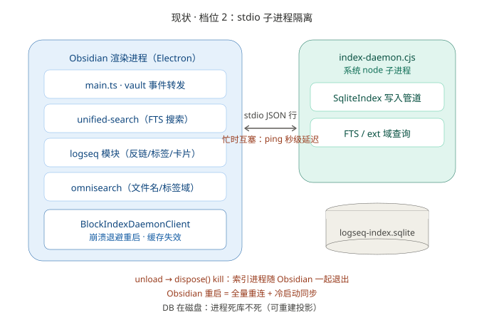
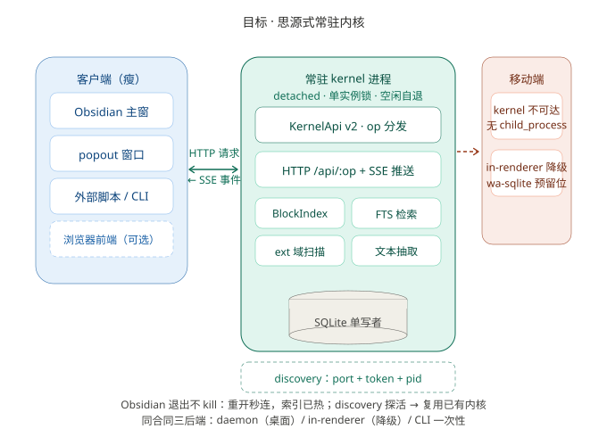
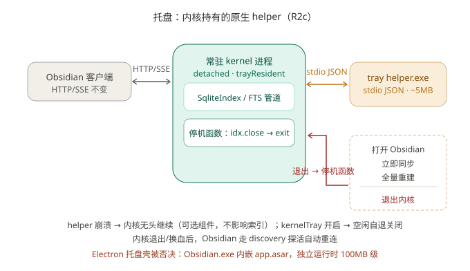

# 内核分离架构设计（R1 传输升级 + R2 生命周期解耦）

> 2026-11-05 定稿。来源：obsidian-my-obsidian 思源式内核分离架构讨论（同日）。
> 前置：`index-daemon.cjs` 档位 2 已上线（daemon-only，2026-10-25 用户指定），
> 本设计不推翻它——`handle()` op 分发、SqliteIndex 写入管道、mutate 互斥、
> turbo 并发池全部原样保留，只升级传输层与生命周期。
> 参照：思源 kernel（127.0.0.1 HTTP + token + workspace 单实例）、本仓
> `docs/unified-index-design.md`、`scripts/deploy.mjs` atomicWriteFile 纪律。

## 0. 一句话

**daemon 从「stdio 子进程」升级为「127.0.0.1 常驻内核」：HTTP RPC + SSE 事件 +
discovery 文件探活复用 + detached 常驻 + 空闲自退；消费方 API 零改动。**

## 1. 现状与差距





| 思源 kernel 特征 | 现状（档位 2） | 差距 |
|---|---|---|
| HTTP API + WS，多前端共用 | stdio JSON 行，单客户端 | 忙时互塞（2026-11-04：omnisearch 搜索堵到 ping 秒级）；外部脚本只能 CLI 一次性另起进程 |
| kernel 常驻，独立于 UI | `dispose()` kill，随 Obsidian 退出 | 重启 Obsidian = 全量重连 + 冷启动同步 |
| workspace 单实例锁 | 无锁 | 双开 Obsidian → 两个 daemon 撞同一 WAL 单写者 |

## 2. 总体决策（9 条）

1. **传输 = HTTP RPC + SSE 事件，不引 ws 包**。流量模型是纯请求/应答 + 单向
   事件广播（daemon→客户端），SSE 足够；node:http 原生实现，零新依赖（同
   hashText 自写 FNV 的纪律），curl 可直接调试。客户端用 fetch + ReadableStream
   手解 SSE（不用 EventSource——避免它的自动重连抢业务语义）。
2. **单实例锁 = 端口绑定本身**。daemon `listen(127.0.0.1, 0)` 随机端口（永不
   冲突）；bind 后自连 `/ping` 自检。第二实例 bind 已占端口属不可能（:0 随机），
   单实例由客户端侧 discovery 探活保证：活着就复用、死了才 spawn。竞态收敛见 §6.4。
3. **discovery 文件放 dbDir（库同目录），不放插件目录**。插件目录在主库网盘内
   （minifilter 热覆盖会写全零块，2026-11-01 教训）；端口/token 是本机概念，
   网盘同步它有害无益；与库同生共死，删库即删发现。
4. **token 认证 + 仅回环**。spawn 时 `crypto.randomBytes(24).toString('base64url')`
   写入 discovery；所有 HTTP 请求带 `X-Kernel-Token`；只绑 127.0.0.1（不触发
   Windows 防火墙弹窗）。本地信任模型与思源同款。
5. **detached 常驻 + 空闲自退**。spawn `detached: true, unref()`，stdio 协议退役
   （stderr 重定向到 `<dbDir>/kernel-<slug>.log` 诊断）；unload 只断连不 kill。
   空闲自退：无 SSE 客户端 且 10min 无请求 且 mutate 不在跑 → `idx.close()` 后
   exit。资源兜底，防僵尸积累。
6. **双栈过渡，默认 stdio + `--http` opt-in**（实施修订 2026-11-05：现役客户端
   spawn 不带任何 flag，R1a 若默认 HTTP 会导致客户端等不到 stdio hello 直接断——
   必须字节级兼容）。one-shot 模式与 CLI `--query` 依赖 stdio，原样不动；
   R1b 客户端切 HttpTransport 后由客户端显式带 `--http`，稳定后再翻默认。
7. **op-aware timeout**。stdio 单一 60s 对 turbo 不够（大库重建 >60s 且靠
   progress 事件续命）。HTTP 按 op 配置超时，见 §5。
8. **消费方零改动**。`BlockIndexDaemonClient` 对外方法签名不变——transport 换在
   类内部；logseq/main.ts、unified-search、omnisearch 的调用点全部不动
   （仅 onunload 行为变）。
9. **配置运行时推送，不依赖出生参数**（2026-11-05 补，托盘「打开 Obsidian」打开
   了资源管理器的事故教训）。detached 内核活得比客户端/构建都久，argv 只在
   spawn 时刻生效——探活复用旧内核、或旧构建拉起的内核永远收不到后加的 flag。
   客户端连接建立后一律 `setConfig` 补推（fire-and-forget）；内核侧关键配置必须
   有非 argv 兜底源（exe → 注册表 obsidian:// 关联），两源皆空明确拒绝并留痕，
   绝不降级到「碰巧不报错的错误行为」（explorer 中间商）。

## 3. discovery 协议

**文件**：`<dbPath 所在目录>/kernel-<vault-slug>.json`
（vault-slug 复用统一索引设计的 sanitize 函数；多 vault 各自独立互不踩）

```json
{
  "proto": 2,
  "pid": 12345,
  "port": 52731,
  "token": "ab3x...",
  "vault": "E:\\HOME\\BaiduSyncdisk",
  "dbPath": "...\\logseq-index.sqlite",
  "startedAt": 1772937600000
}
```

**读写纪律**：
- 写 = atomicWriteFile（tmp + fsync + rename，抄 `scripts/deploy.mjs`）——discovery
  半写状态必须不可见（跨进程读者）。
- 读后必探活：`GET http://127.0.0.1:<port>/ping`（带 token）。探活失败 →
  `process.kill(pid, 0)` 复核进程死 → 覆盖写新 discovery + spawn。
- token 不匹配（别的程序占了端口）→ 视为无内核，换端口重 spawn。
- 客户端永不删 discovery（daemon 自退/启动覆盖维护）；陈旧文件只靠探活兜底。

## 4. KernelApi 契约

新文件 `modules/unified-search/src/daemon/kernelApi.ts`——op 面与现 stdio 协议
一一对应（daemonMain `handle()` 的 switch 原样提炼）：

```ts
export const KERNEL_PROTO = 2;

export interface KernelDiscovery {
  proto: number; pid: number; port: number; token: string;
  vault: string; dbPath: string; startedAt: number;
}

export interface KernelInfo { proto: number; pid: number; vault: string; uptimeMs: number; }

export type KernelOp =
  | { op: 'ping' }
  | { op: 'stats' }
  | { op: 'sync' }
  | { op: 'rebuild' }
  | { op: 'turbo'; mode: 'rebuild' | 'sync' }
  | { op: 'upsert'; paths: string[] }
  | { op: 'delete'; paths: string[] }
  | { op: 'setExclude'; folders: string[] }
  | { op: 'setExt'; files: { path: string; mtime: number }[] }
  | { op: 'extSearch'; tokens: string[]; not?: string[]; limit?: number }
  | { op: 'query'; q: QueryName; args: Record<string, unknown> }
  | { op: 'setConfig'; obsidianExe?: string }
  | { op: 'open' };

export type QueryName =
  | 'getById' | 'blocksByPath' | 'tagsByPath' | 'backlinksTo' | 'refsToBlock'
  | 'supertagInstances' | 'scan' | 'fts' | 'nameSearch'
  | 'withIds' | 'allTags' | 'allCards' | 'supertags';

export type KernelEvent =
  | { ev: 'changed'; version: number }
  | { ev: 'progress'; done: number; total: number };
```

`hello`（proto/pid/vault）改由 `GET /ping` 应答承载 + SSE 首帧广播；`close` op
更名 `shutdown`（语义升级：优雅停内核，不只是关库）。

## 5. HTTP/SSE 传输

**端点**（全部要求 token header，错 → 401）：

| 端点 | 方法 | 语义 | 超时（客户端） |
|---|---|---|---|
| `/ping` | GET | 握手 + 探活 → KernelInfo | 5s |
| `/api/:op` | POST | body = KernelOp 剩余字段 → `{ok,data}` 或 `{ok:false,error}` | 见下 |
| `/events` | GET | SSE 流：`changed` / `progress` / 15s `: ping` 心跳注释帧 | 断线重连 |
| `/shutdown` | POST | 优雅停机（idx.close → server.close → exit） | 5s |

- op 超时：ping 5s / query 类 30s / upsert·delete·sync·setExclude 60s（现值）/
  setExt 120s（ext 首建可长）/ turbo·rebuild 30min（进度走 SSE，应答只是收尾）/
  setConfig 5s / open 10s（spawn 派发即返回，窗口生命周期不归内核管）。
- 幂等重试：所有 op 幂等（syncFile/forgetFile/rebuild 重放安全）→ 网络层失败
  重试一次。server 侧 `keepAliveTimeout` 调 120s 防 fetch 连接复用被 5s 默认值
  掐断（偶发 ECONNRESET）。
- 响应有界性：现协议已保证（scan≤200、fts≤50、nameSearch≤30、all() limit 截断
  1000 行），无分页需求，不搞流式响应。
- mutate 排队语义不变（请求进 HTTP 后仍走 `mutate()` 互斥，排队不回 503，
  由客户端超时兜底）。

## 6. 生命周期

### 6.1 spawn（客户端 `start()`）

```
读 discovery → /ping 探活 → 活:复用（跳过 spawn）→ 开 SSE
                            → 死:复核 pid → spawn detached（stderr→log 文件）→
                              轮询 /ping（100ms × 50）→ 开 SSE → turboSync 后台
```

### 6.2 unload（客户端 `dispose()`）

常驻开关（settings `kernelResident`，默认开）下：只关 SSE + 拒绝 pending，
**不 kill**。开关关（旧行为）或显式「停用内核」按钮：POST /shutdown。

### 6.3 空闲自退（daemon）

定时器 60s 一查：`sseClients==0 && now-lastRequest>10min && !mutateRunning` →
`idx.close()` → exit。SSE 全断后给 30s 宽限（防插件 reload 瞬断误杀）。

### 6.4 双实例竞态收敛

两窗同时冷启动：双方都 spawn → 各自 bind :0 成功（两个内核!）→ 各自写 discovery
（后者覆盖前者）→ 先起窗口的下一次探活发现 discovery 变了、token 不匹配 →
**客户端以 discovery 为准重连新内核，旧内核因 SSE 客户端流失 + 空闲自退**。
收敛靠「discovery 单一真相 + 空闲自退」，不靠文件锁（跨进程文件锁在 Windows
网盘卷上不可靠）。实际影响：竞态窗口只有启动瞬间，且两内核都只读构造、
无数据损坏面（各自独占各自 DB 路径?——不：同 vault 同 dbPath 才有竞态，
此时 WAL 多进程读写 SQLite 自身安全，只是重复建索引浪费；空闲自退 10min 内清掉）。

### 6.5 崩溃恢复

客户端现有 `RESTART_BACKOFF_MS` 退避保留，行为改为「重走 §6.1 流程」（探活→
spawn），不再直接 respawn 固定命令行。

### 6.6 部署衔接

`deploy.mjs` 覆盖 index-daemon.cjs 前读 discovery：内核活着 → 部署后 POST
/shutdown（下次启动自动 spawn 新版）。daemon 常驻持有的是已加载进内存的旧代码，
文件本身可覆盖（node 非锁定），atomicWrite 照旧。

### 6.7 托盘（可选组件，R2c）



思源的托盘由 Electron 前端持有——本内核没有前端，且 Electron 托盘两条路都死：
`Obsidian.exe` 内嵌 app.asar，`exe tray-main.js` 只会拉起 Obsidian 本体；
`ELECTRON_RUN_AS_NODE=1` 能跑但无 GUI API；独立 Electron 运行时 100MB 级，
内存账否决。可行路径 = **原生托盘 helper，内核自己持有**：

- **实现**：systray2 预编译 helper（Windows `tray_windows_release.exe` ~2MB，
  stdio JSON 协议：icon/menu/click/command，常驻内存个位数 MB）。内核 spawn 它
  为子进程，better-sqlite3 同款 sidecar 纪律（esbuild external + deploy 边车 +
  `yarn unplug`）。**实施第一步先跑探针验证 helper 协议细节**（菜单结构/点击
  事件/exit 命令），不凭文档记忆写代码。
- **菜单**：打开 Obsidian（协议 URL 直派 exe：runtime `setConfig`/argv → 注册表
  obsidian:// 关联兜底 → 两源皆空拒绝；无 shell.openExternal——内核是纯 node）/ 立即同步 /
  全量重建 / ——分隔线 / **退出内核**。tooltip 显示「索引内核 · 运行中 · N 文件」。
  图标 `<pluginDir>/assets/kernel.ico`（静态手绘一次，不做构建期转换——不为此引
  依赖）。
- **退出语义（右键退出 = 思源同款）**：菜单点击 → stdio 事件回内核 → 内核走
  显式停机路径（idx.close → helper 退出 → 进程 exit）。与 `/shutdown` 端点同一
  条停机函数，两入口一个语义。
- **降级**：helper 崩溃/启动失败 → 内核无头继续（stderr 记一笔，不重启 helper），
  可选组件绝不影响索引可用性；下次内核重启自动再试。
- **与空闲自退互斥**：settings.kernelTray（默认关）开启 → §6.3 空闲自退关闭
  （托盘即常驻语义，否则托盘活着内核自己退了，状态误导）。Obsidian 客户端零
  感知——内核退出/换血后走既有 discovery 探活重连路径。
- **被否决的备选**：PowerShell NotifyIcon（零新二进制但 PowerShell 进程
  40-80MB 且脆）；Electron 托盘壳（见上）。

## 7. 改动文件清单

| 文件 | 改动 |
|---|---|
| `modules/unified-search/src/daemon/kernelApi.ts` | **新增**：类型 + discovery 读写 + slug/token 工具 |
| `modules/unified-search/src/daemon/httpServer.ts` | **新增**：node:http + SSE，绑现 `handle()` |
| `modules/unified-search/src/daemon/daemonMain.ts` | 守护模式默认起 httpServer（`--stdio` 逃生口）；`write()` 事件改道 SSE 广播；`close`→`shutdown` |
| `modules/unified-search/src/daemon/daemonClient.ts` | Transport 抽象：StdioTransport（现逻辑收编）+ HttpTransport（fetch/SSE + discovery）；spawn detached；dispose 不 kill |
| `modules/logseq/src/main.ts` | `startDaemonIndex` 传参；onunload 分支按 `kernelResident` 分流（**外科手术，仅此两处**） |
| `modules/logseq/src/settings/tab.ts` | 守护区加「常驻内核」开关 + 「停用内核」按钮；「内核托盘」开关（R2c） |
| `package.json` + deploy 边车 | systray2 依赖（external）+ `tray_windows_release.exe` + `assets/kernel.ico`（R2c） |
| `esbuild.mjs` | **不动**（platform:node 自动 external node:http） |

## 8. 陷阱清单

- spawn cwd 绝对路径（2026-10-25 教训，现 daemonClient 已修，保持）
- stderr 重定向文件写 `CREATE_NEW` 失败处理（log 文件被占用时换行追加模式）
- fetch 到 127.0.0.1 不受 Obsidian CSP connect-src 限制（_usjs-server 探针先例），
  但要 `keepalive: false` 默认即可；Node 24 renderer fetch 对 http:// 明文回环放行
- SSE 手解：按 `\n\n` 分帧，`: ` 开头是心跳注释跳过，`event:`/`data:` 两行解析
- discovery 覆盖写竞态：两内核同写 → 最后写者胜，客户端 token 不匹配即重连，
  自愈路径已覆盖（§6.4）
- `forwardVaultEvents` 双窗双注册 → 双写 upsert 队列：无害（幂等）但浪费，
  R3 再按「主窗才能注册」收敛，本轮不做
- turbo 进行中禁自退（§6.3 已含）；turbo 期间客户端超时 30min 与 idle 10min
  不冲突（有请求活性即不算 idle）
- **explorer.exe 不是协议派发中间商**（2026-11-05 实测）：`explorer.exe
  "obsidian://open?vault=…"` 打开的是资源管理器窗口，URL 派发静默无效。协议
  URL 必须直派注册表 command 里的 exe（argv 传 URL 即 %1 原样行为）
- **重载 Obsidian ≠ 内核换参数**：常驻内核 detached，探活复用后新 flag 永远
  进不了已活内核的 argv——运行时配置只能 setConfig 推送（决策 9）

## 9. 测试与验收

- vitest（node 环境）：kernelApi 纯函数（slug/token/discovery 原子写）；httpServer
  起真服 → /ping//api/query//events 收帧断言；双 spawn 竞态模拟
- e2e `_probe-kernel-*.mjs`（不入库）：起内核 → ping → fts 查询 → SSE 收 changed
  → 杀客户端 → 内核存活 → 二连复用 → idle 自退计时验证
- 手动：双 Obsidian 实例开同库；reload plugin 零冷启动；部署新版触发 shutdown

## 10. 分阶段交付

1. ✅ **R1a（已交付 2026-11-05）**：kernelApi.ts（契约+discovery 注入式读写，纯
   模块——主 bundle browser platform 不可静态解析 fs/crypto）+ httpServer.ts
   （node:http+SSE+token+15s 心跳）+ daemonMain 接线（`--http` opt-in，默认
   stdio 字节级兼容；事件经 emit() 改道 SSE；新增 shutdown op）。验收：tsc 全绿；
   vitest 6/6（`yarn test:kernel`）；真机冒烟 PASS（bundle→spawn→discovery→
   401/ping→SSE hello→rebuild→upsert→withIds 命中→changed 广播→/shutdown
   优雅退出 116ms）。客户端仍 stdio，互不干扰
2. ✅ **R1b（已交付 2026-11-05）**：httpTransport.ts（discovery 探活复用 → spawn
   `--http` → 轮询就绪 → SSE 事件流；op-aware 超时；stop=/shutdown+kill 兜底）+
   daemonClient 双 transport（HTTP 优先、失败回落 stdio——部署偏斜安全：旧
   daemon.cjs 忽略未知 flag 走 stdio）；**消费方 API 零改动**（logseq/main.ts
   未动，transport 默认 http）。kill 语义暂留（unload 仍 /shutdown，R2a 解耦）。
   验收：tsc 全绿；vitest 9/9（复用/spawn 轮询/超时三路径）；client 冒烟 PASS
   （382ms 连接，withIds 命中，事件序列 hello/progress/changed/fts）；真实构建
   `--http` 已入 main.js 与 index-daemon.cjs。部署实测（真 Obsidian + 主库）待做
3. ✅ **R2a（已交付 2026-11-05）**：daemon 空闲自退（`--idle-exit-ms` 默认 10min，
   0=禁用留给 R2c 托盘；mutate 进行中豁免；检查周期 min(60s, idle/4)）+
   gracefulStop 收敛点（/shutdown 与 idle 共用）+ transport `resident` spawn
   （detached + unref + windowsHide + stderr→`kernel-<slug>.log`）+ `disconnect()`
   （只断 SSE 不杀）+ client dispose 常驻分支（`kernelResident` 默认开，`!== false`
   归一化同 sqliteIndexEnabled 先例）+ `stopKernel()` 显式停机 + settings「常驻
   内核」开关与「停用内核」按钮。验收：tsc 全绿；vitest 10/10（disconnect 复用
   语义）；R2a 冒烟 PASS——孤儿存活（中介父进程死后续活）/3.1s 空闲自退/活性
   豁免（5.5s 仍活）；`yarn build:fast` 零错误
4. ✅ **R2b（已交付 2026-11-05）**：deploy.mjs 内核换血钩子——部署
   index-daemon.cjs 成功后，扫 dbDir（data.json 的 sqliteDbDir + 默认目录）
   的 kernel-*.json，vault 匹配且探活则 POST /shutdown；Obsidian 开着时
   客户端退避重启自动 spawn 新内核（秒级热换血，用户无感）。验收：R2b 冒烟
   PASS（临时库真跑 deploy.mjs --only index-daemon.cjs → 钩子触发 → 内核
   exit=0）。

### 手测矩阵（2026-11-06 深夜全部自动化执行完毕,探针在 tests/e2e/_matrix-*.mjs）

- [x] 部署 → 重载 → 搜索/反链正常（HTTP 通道）——fts/scan/backlinksTo 三查询经 daemonIndex.call 实测（M1）
- [x] 重启 Obsidian：秒连（discovery 复用）——热 reload 1.5s / 冷启动 3.5s（_kernel-bench 实测）
- [x] 空闲自退：无托盘内核 + --idle-exit-ms 15000,5s 存活 / 20s 自退（M3,短窗口实测）
- [x] 双开同库：第二实例复用同内核（pid 不变）,查询通;关一窗内核仍活（M4）
- [x] 网盘安全：部署输出 sha256 ✓;kernel-*.log 诊断可用（多次换血实证）
- [x] 停用开关：sqliteIndexEnabled=false → daemonIndex null（daemon-only 无索引）;true → 自动拉起（M6）
- [x] 常驻关 → 优雅退出（CDP Browser.close）内核即停（M7）。**注意：taskkill /F 强杀不跑 unload,内核会残留——矩阵原意是优雅退出**
- 附带发现：换血窗口期 spawn 的内核会撞边车半拷贝（Cannot find module file-uri-to-path）→ 静默降级 node:sqlite 无 FTS 整个内核生命周期。已加 better-sqlite3 加载重试（3 次 × 2s）
5. ✅ **R2c（已交付 2026-11-05）**：内核托盘。探针先行（tmp/_probe-tray.mjs）实测
   systray2 2.1.4 协议：**default 双层包装**（require('systray2').default 才是
   类）/ **onError 必须 ready 后注册**（否则 _process null 崩）/ kill(false) 防
   误杀宿主 / MenuItem 无 id 按 title 分发 / PNG-in-ICO 零依赖生成可用
   （tmp/_gen-ico.mjs → assets/kernel.ico,123 字节）。落地：kernelTray.ts（JS 打
   进 bundle——fs-extra/debug 随包进来,**边车只剩 traybin 二进制 3.5MB**,helper
   经 __dirname/traybin 解析=bundle 所在插件目录）+ daemonMain `--tray`（四动作
   走 handle 同一 op 路径,退出走 gracefulStop,exit 钩子 killSync 防孤儿图标,
   与空闲自退互斥）+ client `--tray --idle-exit-ms 0` + settings.kernelTray
   （默认关）+ deploy.mjs traybin 边车（PnP resolve）。验收：tsc 全绿;vitest
   10/10;R2c 冒烟 PASS（helper 进程真实存在,/shutdown 后 helper 一并回收）;
   build:fast 零错误。**托盘点击交互（打开/同步/重建/退出四菜单项）需真机手点
   验证**——冒烟只覆盖 spawn/回收与动作接线。

## 11. 明确不做

- 浏览器多前端（kernel serve 静态页）——价值有限，R5 再议
- kernel 内设置域（loadData/saveData 渲染进程足够）
- 移动端 kernel（无 child_process，永远 in-renderer + WasmSqliteBackend 降级，
  接口位已在 unified-index-design §11 预留）
- 跨机内核（本设计是本机回环，与 livesync 的同步域正交）
- 全 gRPC/二进制协议——JSON 行语义平移，量级不需要
- Electron 托盘壳（Obsidian.exe 内嵌 app.asar 不能当通用 Electron 用，独立运行时
  100MB 级内存账不成立）；托盘只走原生 helper（§6.7），且默认关闭
